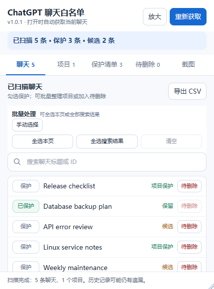
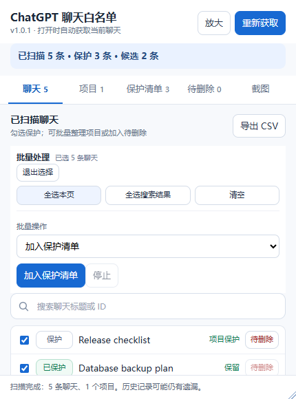
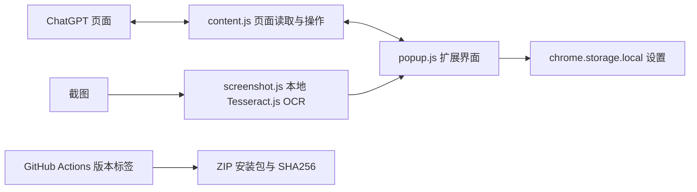

# ChatGPT 聊天白名单助手

**Chrome / Edge · Manifest V3 · v1.0.1**

扫描、保护和整理 ChatGPT 聊天；删除前可逐条核对。

  
  

> 截图使用虚构聊天标题，仅展示界面。

## 功能

- 自动扫描当前页面侧栏已加载的聊天；滚动侧栏时继续补充，并可搜索标题或 ID。
- 用手动保护、标题关键词和项目规则保护聊天；支持按页或按搜索结果批量选择。
- 批量加入保护清单、加入待删除，或移入/移出项目；支持在 ChatGPT 中新建项目。
- 粘贴或上传截图进行本地 OCR，核对匹配后加入保护清单或待删除。
- 导出 CSV。删除前核对清单并确认；每条聊天都会重新校验，异常时停止。

## 安装与使用

1. 从 [v1.0.1 Release](https://github.com/1447443432/ChatGPT_Chat_Manager/releases/tag/v1.0.1) 下载 ZIP 并解压。
2. 在 `chrome://extensions/` 或 `edge://extensions/` 开启“开发人员模式”，选择“加载解压缩的扩展”，载入解压目录。
3. 打开或刷新 ChatGPT 页面，再点击扩展图标。扩展会自动获取当前侧栏聊天。
4. 在“聊天”页搜索并批量处理；删除请到“待删除”页核对并确认。

## 架构与技术

- **前端：** HTML、CSS、原生 JavaScript，Chrome / Edge Extension Manifest V3。
- **OCR：** 随扩展打包的 Tesseract.js 与中英文模型，本地识别，不调用远程 OCR 服务。
- **发布：** 推送 `v主版本.次版本.补丁版本` 标签后构建 Release；普通提交和 README 修改不会触发发布。
- 更详细的数据流和删除校验见[架构说明](docs/ARCHITECTURE.md)。

## 范围与隐私

- 扫描当前页面侧栏已加载的聊天，不代表账号完整历史；未加载的历史需要在 ChatGPT 侧栏中继续滚动。
- 设置保存在浏览器本地；OCR 在本地执行。内容脚本仅注入 ChatGPT 页面，不接入第三方服务；多账号建议使用不同浏览器配置文件。
- 删除通过当前 ChatGPT 页面会话执行，删除不可恢复；站点接口或页面变化可能导致操作失败。

## 开发

开发时可在扩展管理页载入仓库的 `extension/` 目录。需要 Node.js，运行 `npm test` 校验项目。
